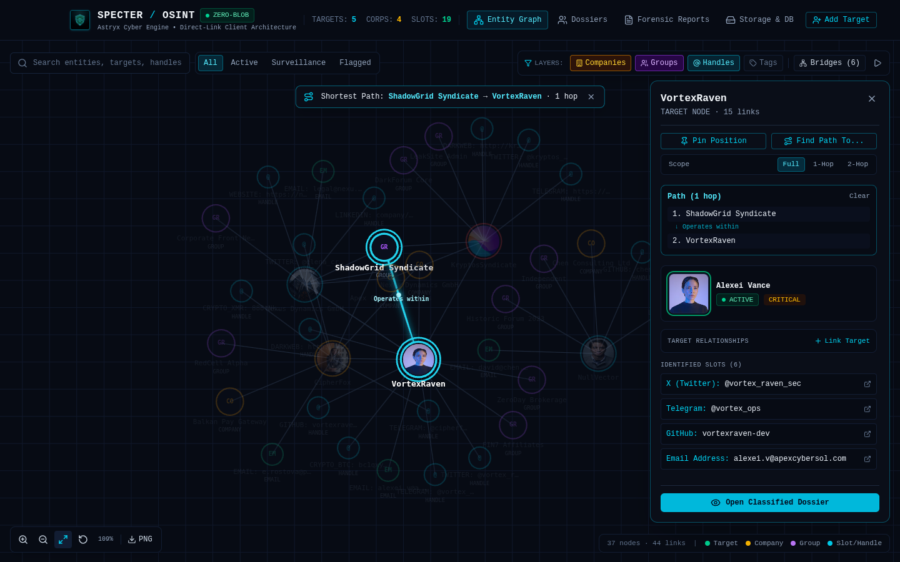
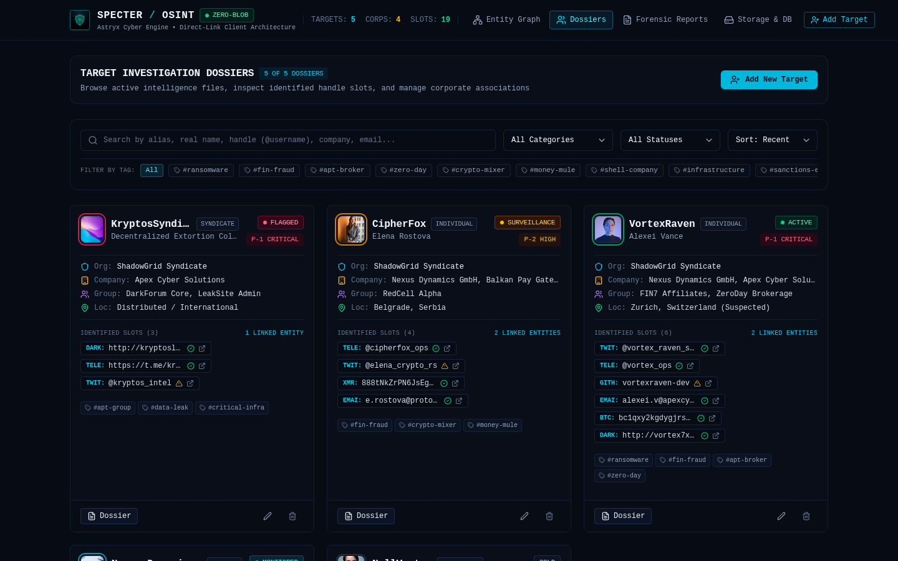
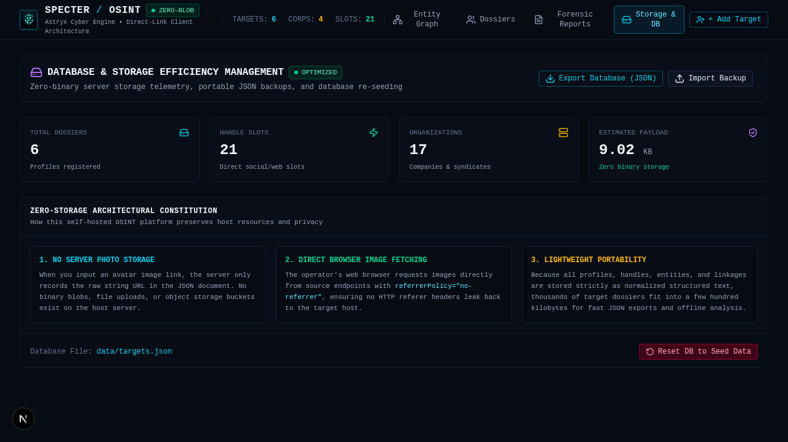
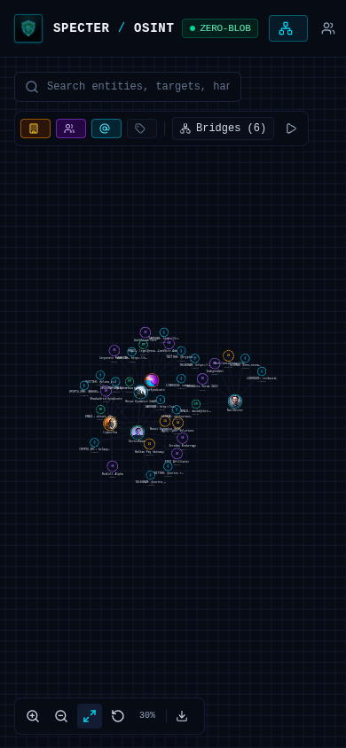

<p align="center">
  
</p>

<h1 align="center">SPECTER // OSINT</h1>

<p align="center">
  <strong>Self-hosted intelligence dossier profiling platform with interactive entity link graph and zero-blob server media storage.</strong>
</p>

<p align="center">
  
  
  
  
  
</p>

---

SPECTER is a lightweight, self-hosted OSINT (Open Source Intelligence) investigation workbench designed for security analysts, threat researchers, and investigators. It tracks threat actors, organizations, corporate shells, and identified online account slots without consuming server disk space for media storage.

Profile photos and evidence assets are loaded directly by the operator's web browser from external target URLs with automatic referrer stripping (`referrerPolicy="no-referrer"`), eliminating server-side binary uploads, proxy bandwidth costs, and origin referrer leakage.

## Screenshots

### Interactive Entity Link Graph
Explore connection topologies, organizational bridges, and shared infrastructure clusters in an interactive force canvas.



### Investigation Dossiers Dashboard
High-density target cards styled with Meta's Astryx design system, featuring live surveillance indicators, category badges, handle slots, and direct profile actions.



### Storage Efficiency & Zero-Blob Telemetry
Real-time database payload metrics, portable JSON backup exports, and zero-binary storage guarantees.



### Responsive Mobile Interface
Full-featured responsive layout adapted for tablet and mobile devices with touch navigation.

<p align="center">
  
</p>

---

## Key Features

- **Interactive Entity Link Graph**: Canvas-based physics graph that links individuals, corporate shells, syndicates, and handle slots with dynamic node filtering, zoom navigation, and slide-in inspector drawer.
- **Zero-Blob Media Architecture**: The server strictly stores raw URL text strings in JSON. No binary files, image uploads, or S3 object buckets exist on the host server.
- **Client-Direct Asset Loading**: Operator browsers fetch images directly from the target endpoint with `referrerPolicy="no-referrer"`, preventing target servers from tracing requests back to the OSINT host.
- **Meta Astryx Design System**: Fully redesigned using Astryx component primitives (`AstryxCard`, `AstryxBadge`, `AstryxButton`, `AstryxInput`, `AstryxSelect`, `AstryxModal`, `AstryxDrawer`, `AstryxTable`, `AstryxAvatar`) in an obsidian dark cyber theme with cyan (`#06b6d4`) and emerald (`#10b981`) accents.
- **Online Handle & Account Slots**: Categorized handle slots across 18+ platforms (Twitter/X, Telegram, GitHub, LinkedIn, Darkweb .onion, Crypto Wallets, Custom) with verification status (`verified`, `suspected`, `impersonator`).
- **Forensic Checksums**: Deterministic SHA-256 cryptographic digest calculation per target profile for evidentiary chain-of-custody verification.
- **One-Click Dossier Reports**: Instant exportable and printable plaintext intelligence briefs.
- **Portable JSON Storage**: Target database stored as structured JSON (`data/targets.json`), allowing instant backups, restores, and seamless migration.

---

## Architectural Principles

> [!IMPORTANT]
> **Zero Binary Server Storage**  
> Under no circumstances does the SPECTER backend accept base64 image strings or file uploads. Avatar and evidence slots accept strictly HTTP/HTTPS URL links. This guarantees minimal host resource consumption, with hundreds of detailed dossiers taking less than 100 KB of disk space.

> [!NOTE]
> **Operational Security (OPSEC)**  
> All client-side image tags enforce `referrerPolicy="no-referrer"`. When an analyst views a target's profile photo hosted on an external server, the browser strips the HTTP `Referer` header to ensure the host domain is never transmitted to third-party logs.

> [!TIP]
> **Self-Contained Local Primitives**  
> Astryx component primitives reside locally in `components/astryx/` without external proprietary bundler dependencies, ensuring long-term self-hosted stability.

---

## Tech Stack

| Layer | Technology |
| --- | --- |
| **Framework** | Next.js 15 (App Router, Standalone Output) |
| **Language** | TypeScript (Strict Mode) |
| **Styling** | Tailwind CSS v4, PostCSS, CSS Tokens |
| **Design System** | Meta Astryx Primitives (`components/astryx/`) |
| **Icons** | Lucide React |
| **Graph Simulation** | HTML5 Canvas 2D Force-Directed Simulation |
| **Database** | Structured JSON Persistence (`data/targets.json`) |
| **Testing** | Node.js Native Test Runner (`node:test`, `tsx`) |
| **Browser QA** | Playwright CLI (`@playwright/cli`) |

## AI Agent Setup

#copy this to agent and setup on user device
```text
You are an autonomous setup engineer for SPECTER OSINT. Follow these instructions:
1. Clone repository and enter project directory:
   git clone <REPO_URL> && cd specter-osint
2. Install project dependencies:
   npm install
3. Validate unit test suite and production build:
   npx tsx --test lib/osint-engine.test.ts && npm run build
4. Start local development server on port 3000:
   npm run dev -- -p 3000
5. Verify http://localhost:3000 is accepting connections and ask the user:
   "SPECTER OSINT platform is operational on http://localhost:3000. Do you need any help to set up demo dossiers (e.g. PhishPhantom, KryptosSyndicate, VortexRaven) or register new intelligence targets?"
```

---

## Quick Start

### Prerequisites

- Node.js 20.x or higher
- npm, pnpm, or bun

### Installation

1. Clone or navigate to the repository:
   ```bash
   cd specter-osint
   ```

2. Install dependencies:
   ```bash
   npm install
   ```

3. Configure environment variables (optional for local self-hosting):
   ```bash
   cp .env.example .env.local
   ```

4. Launch the local development server:
   ```bash
   npm run dev
   ```

5. Open [http://localhost:3000](http://localhost:3000) in your browser.

---

## Verification & Testing

Run unit tests verifying URL formatting, base64 payload rejection, graph link assembly, and SHA-256 forensic checksum calculation:

```bash
npx tsx --test lib/osint-engine.test.ts
```

Compile the optimized standalone production build:

```bash
npm run build
```

Run ESLint verification:

```bash
npm run lint
```

---

## REST API Reference

SPECTER provides a lightweight REST API for programmatic ingestion and integration:

| Method | Endpoint | Description |
| --- | --- | --- |
| `GET` | `/api/profiles` | Retrieve all target investigation dossiers |
| `POST` | `/api/profiles` | Create or update a target dossier |
| `DELETE` | `/api/profiles?id={id}` | Delete a target dossier by ID |
| `PUT` | `/api/profiles` | Execute database operations (`reset` to seed data or `import` batch array) |

### Sample Target Dossier Schema

```json
{
  "id": "tgt-1794300464018-afbvz",
  "alias": "PhishPhantom",
  "realName": "Marcus Thorne",
  "category": "individual",
  "status": "active",
  "priority": "medium",
  "avatarUrl": "https://images.unsplash.com/photo-1507003211169-0a1dd7228f2d?w=256&auto=format&fit=crop&q=80",
  "organization": "ShadowGrid Syndicate",
  "location": "Geneva, Switzerland",
  "companies": ["Apex Cyber Solutions"],
  "groups": ["PhishOps Team"],
  "tags": ["#phishing", "#infostealer"],
  "handles": [
    {
      "id": "h-1",
      "platform": "twitter",
      "value": "@phantom_sec",
      "verified": "verified"
    },
    {
      "id": "h-2",
      "platform": "telegram",
      "value": "@phantom_intel",
      "verified": "verified"
    }
  ],
  "relationships": [],
  "notes": "Identified operating high-volume credential harvesting kit.",
  "createdAt": "2026-11-10T15:47:44.018Z",
  "updatedAt": "2026-11-10T15:47:44.018Z"
}
```
